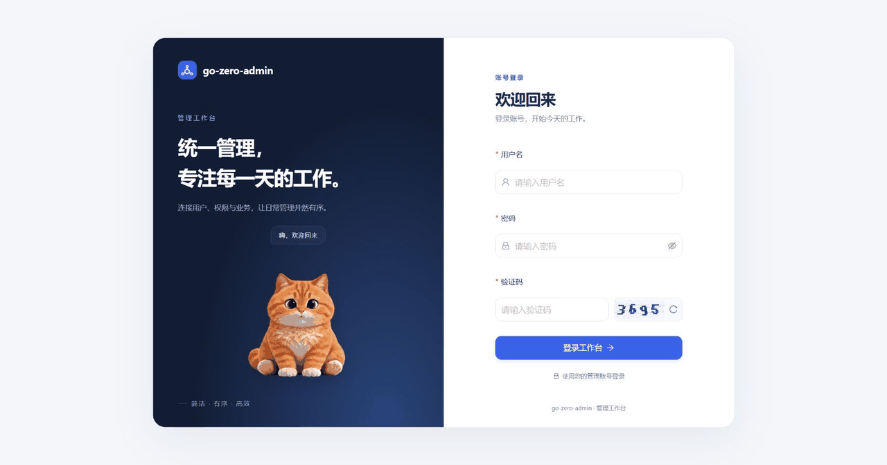
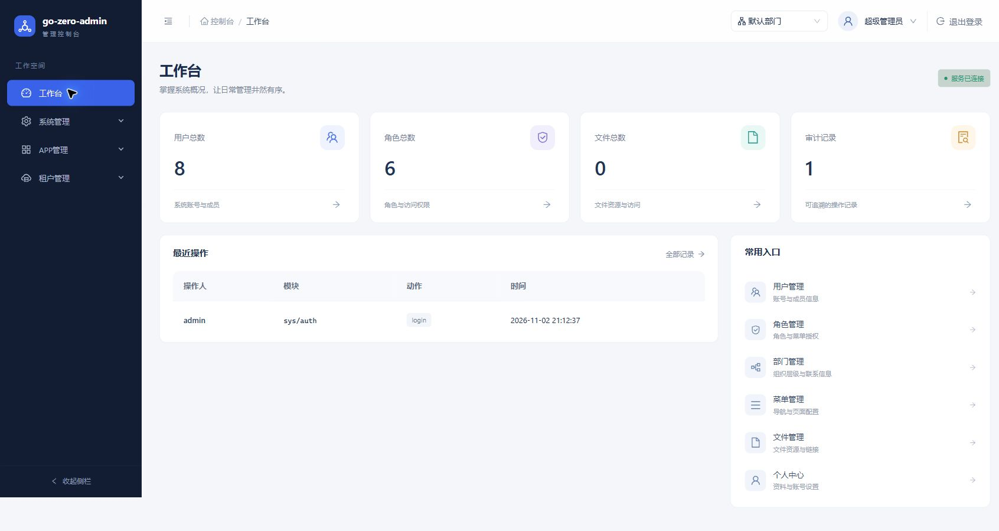
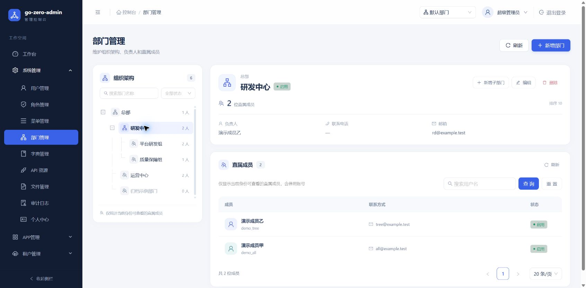
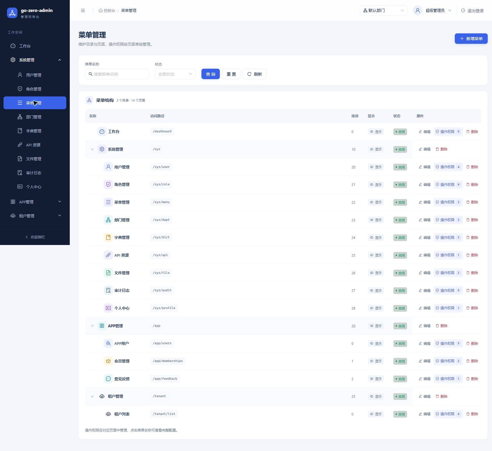
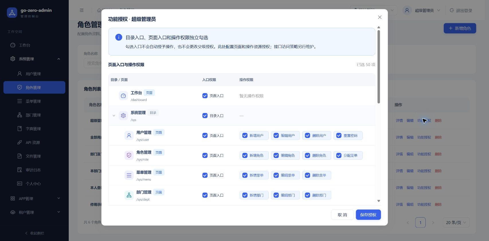
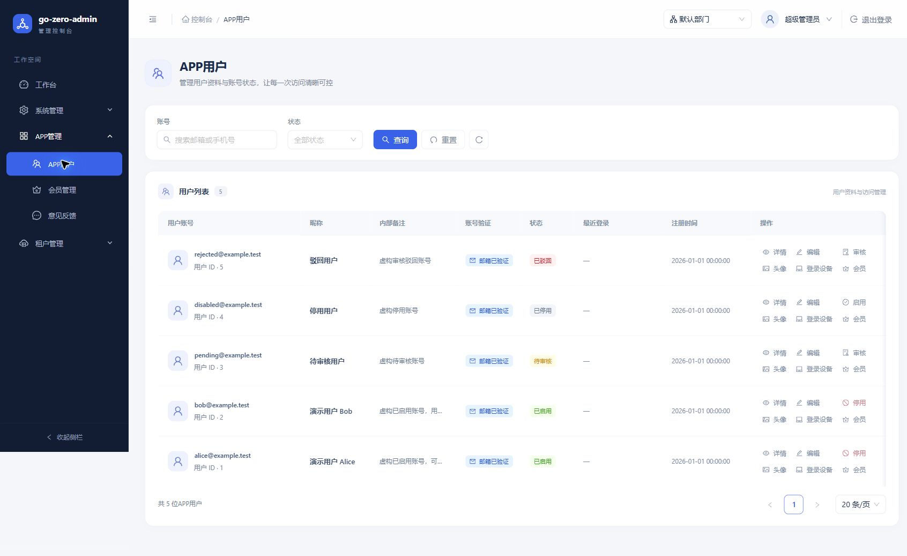
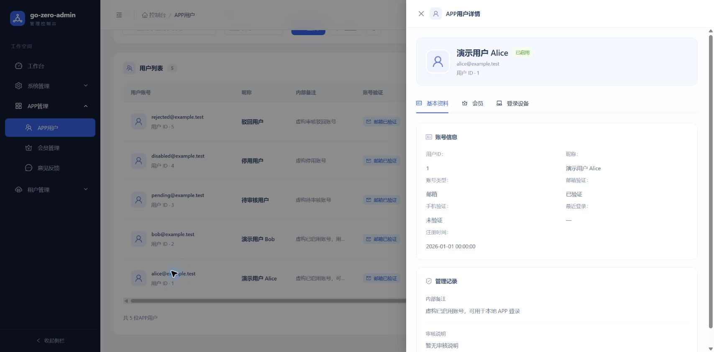
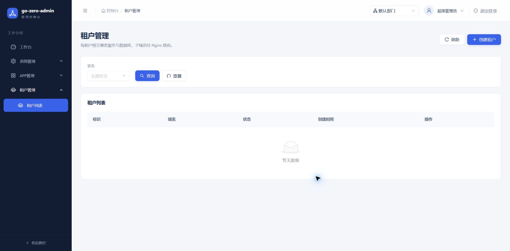

# go-zero-admin

[](https://github.com/yh-zero/go-zero-admin/actions/workflows/ci.yml)

基于 **go-zero + React** 的管理后台，包含权限、部门、文件、审计和 APP 用户管理，适合作为业务系统的开发起点。

后端采用 **1 个 HTTP API + 5 个 RPC 服务**（admin / app / file / ai / tenant），前端采用 React 19、TypeScript 和 Ant Design 6。

CI 在推送代码、提交 PR 或手动触发时，自动执行后端 `verify.ps1`、前端类型检查与构建；结果见上方状态标识或仓库 Actions 页面。

## 功能

| 模块 | 功能 |
|---|---|
| 工作台 | 当前部门与授权范围内的统计、最近操作和常用入口 |
| 系统管理 | 用户、角色、菜单、部门、字典、API 资源、文件、审计和个人中心 |
| 权限控制 | JWT、Casbin、部门身份和数据范围；页面入口与操作权限分开授权 |
| APP管理 | 用户资料与审核、头像、登录设备、会员开通/撤销和反馈回复 |
| 租户管理 | 与 APP 管理同级的导航，支持列表、状态筛选和只读详情 |
| AI / 租户接口 | AI 会话、工作流、任务审批，以及租户生命周期 HTTP/RPC 接口 |

APP 端另有独立的认证、资料、会员和反馈接口。租户运行栈需另行创建和配置；初始化库不附带虚构的运行栈或租户凭据。

## 快速开始

准备 **Go 1.27.3、PowerShell、Docker（Linux 容器）及 Compose、Node.js 24、pnpm 11.28.5**。

在仓库根目录打开 PowerShell，启动后端：

```powershell
cd go-zero-admin
if (-not (Test-Path -LiteralPath .env.local)) { Copy-Item .env.local.example .env.local }
# 按需编辑 .env.local，填写 AI Key 或 SMTP 邮箱及授权码
powershell -NoProfile -ExecutionPolicy Bypass -File .\data\scripts\build-images.ps1
docker compose --env-file .env.local up -d --build --wait
```

Dockerfile 使用宿主机预编译的 Linux 二进制；首次运行或修改后端代码后，先执行构建脚本。基础镜像需可拉取或已缓存。

另开终端，从仓库根目录启动前端：

```powershell
cd go-zero-admin-react
pnpm install --frozen-lockfile
pnpm dev
```

访问 [http://127.0.0.1:5999](http://127.0.0.1:5999)，演示管理员：`admin / Admin@123456`。默认开启图片验证码，前端请求代理到 API 的 `7001` 端口。

权限演示账号：`demo_all`、`demo_tree`、`demo_dept`、`demo_self`，分别查看全部、本部门及下级、本部门、本人数据，密码同上；`demo_tree` 可切换部门比较范围。APP 示例账号为 `alice@example.test`，密码同上。演示凭据仅限本地开发。

- **初始化数据**：[mysql-all.sql](go-zero-admin/data/db/init/mysql-all.sql) 包含完整表结构与可公开的演示数据。MySQL 空数据卷首次启动自动导入；已有数据卷不会自动覆盖或更新。
- **可选配置**：AI 和邮件不影响基础后台启动，配置项见 [.env.local.example](go-zero-admin/.env.local.example)。本地配置不提交到仓库；历史完整备份见 [20261102](go-zero-admin/data/db/init/20261102)，首次初始化仍使用 `mysql-all.sql`。
- **配置位置**：容器使用 `go-zero-admin/docker/etc/*.yaml`，宿主运行使用各服务的 `etc/*.yaml`。验证码开关为 admin-rpc 的 `Captcha.Enabled`。

详细启动、数据库初始化和排障说明见 [开发手册](ai_document/dev-guide.md)，未覆盖的外部联调和异常场景见 [剩余事项](ai_document/README.md#后端剩余事项)。

## 界面预览

以下为当前版本重新拍摄的界面。

### 猫咪登录

Rive 猫咪默认开启互动，支持呼吸、眨眼、鼠标跟随、输入密码时捂眼及登录成功/失败反馈。小屏幕隐藏装饰角色，加载失败时使用静态备用图。



### 工作台



### 部门管理

组织树、部门概览和直属成员分区展示。



### 菜单与角色授权

菜单树维护目录和页面，操作权限按页面单独管理。





### APP管理

集中维护用户资料、会员、设备和账号状态。





### 租户管理

读取租户状态和详情；全新初始化库的租户列表为空。初始化超级管理员拥有完整菜单，创建、启停等生命周期操作需配置租户运行环境后使用。



## 项目结构

```text
├── go-zero-admin/          后端：application / data / docker / pkg
├── go-zero-admin-react/    React 管理前端
└── ai_document/            项目文档与截图
```

后端主要使用 go-zero、gRPC、JWT、Casbin、sqlx；前端主要使用 React、Ant Design、TanStack Query、zustand 和 Rive。数据与部署使用 MySQL、Redis、RustFS、Nginx 和 Docker Compose。具体版本以 [go.mod](go-zero-admin/go.mod)、[package.json](go-zero-admin-react/package.json) 和锁文件为准。

## 开发文档

- [开发手册](ai_document/dev-guide.md)：环境、启动、初始化、排障与猫咪动画维护
- [API 契约](ai_document/api-contract.md)：当前字段、权限、业务语义和能力边界；未完成事项见[问题清单](ai_document/README.md#后端剩余事项)
- [架构规划](ai_document/refactor-plan.md)：架构与后续方向
- [前端说明](go-zero-admin-react/README.md)：页面、命令与对接约定
- [开发规范](AGENTS.md)：通用规则及前后端规范入口
