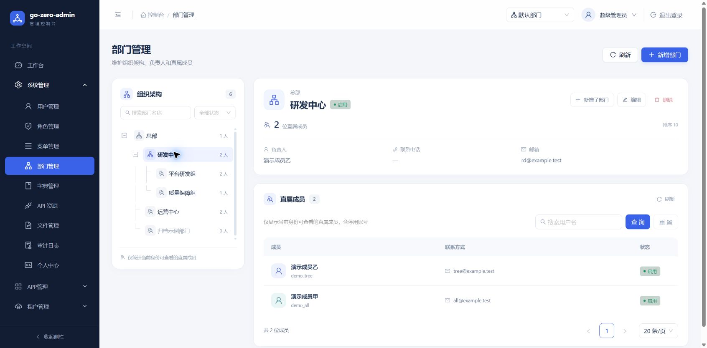
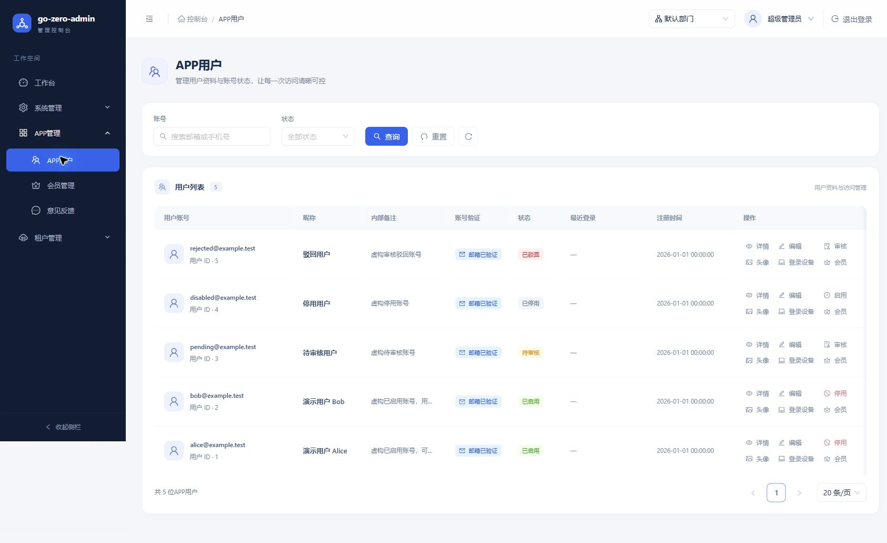
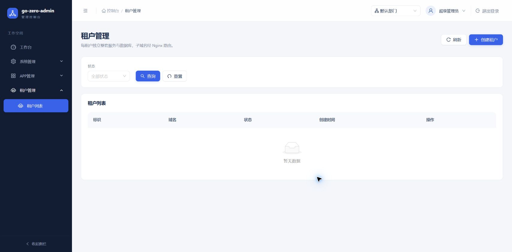

# go-zero-admin

[](https://github.com/yh-zero/go-zero-admin/actions/workflows/ci.yml) · [视频教程](https://www.bilibili.com/video/BV15mW76qE3J/) · [MIT 许可证](LICENSE)

go-zero-admin 是基于 go-zero、React 和 Ant Design 的开源管理后台。开箱即可管理用户、部门、角色权限、文件和审计记录。配置模型后，还可以用自己的资料进行知识库问答，运行带审批的工作流并查看用量。

## 快速开始

以下命令使用 **Windows PowerShell**。开始前准备好以下工具。

- Git 和 Go 1.27.3。[后端版本](go-zero-admin/go.mod)
- 已启动的 Docker，使用支持 `linux/amd64` 的 Linux 容器，以及 Docker Compose 2.24.0 或更高版本。[Compose 配置要求](https://docs.docker.com/reference/compose-file/services/#required)
- Node.js 24 和 pnpm 11.28.5。[前端版本](go-zero-admin-react/package.json)

首次构建需要下载 Go 模块、前端依赖和容器镜像。启动基础后台可以留空 AI 和邮件配置。

### 1. 获取项目

```powershell
git clone --recursive https://github.com/yh-zero/go-zero-admin.git
cd go-zero-admin
```

这里是**仓库根目录**，其中同名的 `go-zero-admin/` 子目录才是后端。已克隆项目但缺少 `.ai-context/` 中的规范文件时，在仓库根目录运行 `git submodule update --init --recursive`。

### 2. 启动后端并检查就绪状态

在当前终端进入后端目录。构建脚本先在宿主机编译 1 个 API 和 5 个 RPC 服务的 Linux 二进制，Compose 再将它们打包并启动。

```powershell
cd go-zero-admin
if (-not (Test-Path -LiteralPath .env.local)) { Copy-Item .env.local.example .env.local -ErrorAction Stop }
powershell -NoProfile -ExecutionPolicy Bypass -File .\data\scripts\build-images.ps1
if ($LASTEXITCODE -ne 0) { throw "后端编译失败" }
docker compose --env-file .env.local up -d --build --wait
if ($LASTEXITCODE -ne 0) { throw "Compose 启动失败，请检查容器日志" }
Invoke-RestMethod http://127.0.0.1:7001/ready | ConvertTo-Json -Depth 3
```

看到 `code` 为 `200`、`result.ready` 为 `true` 后启动前端。若首次请求仍返回 503，稍候重试；持续未就绪时，在后端目录运行 `docker compose --env-file .env.local logs --tail 50 api admin-rpc mysql redis`。[启动与排障](ai_document/dev-guide.md#2-构建启动与就绪检查)

MySQL 空数据卷首次启动会自动导入[初始化 SQL](go-zero-admin/data/db/init/mysql-all.sql)。已有数据卷沿用原数据和密码。初始化 SQL 会重建业务表，升级已有库前请先阅读[数据初始化说明](ai_document/dev-guide.md#数据初始化)。

### 3. 启动前端并登录

另开一个 PowerShell 终端，从**仓库根目录**执行以下命令。

```powershell
cd go-zero-admin-react
pnpm install --frozen-lockfile
if ($LASTEXITCODE -ne 0) { throw "前端依赖安装失败" }
pnpm dev
```

打开[本地管理后台](http://127.0.0.1:5999)。全新开发库的演示账号是 `admin`，密码是 `Admin@123456`。填写页面上的图形验证码登录。看到工作台后，打开用户列表，能读到初始化用户就说明前端代理、后端登录和数据读取已串通。

## 从资料到有来源的回答

在后端 `.env.local` 配置聊天模型密钥（默认 DeepSeek 使用 `AI_DEEPSEEK_KEY`）；知识库还需要独立的 Embedding 密钥 `AI_QWEN_KEY` 和 Compose 中的 Qdrant。修改后在后端目录运行 `docker compose --env-file .env.local up -d --force-recreate ai-rpc`。模型调用和向量化可能产生供应商费用。[模型与邮件配置](ai_document/dev-guide.md#ai-与邮件)

进入「AI 功能 → 知识库」，新建知识库，导入一篇 UTF-8 TXT 或 Markdown（每篇最多 64 KiB）。等资料显示「可使用」，输入问题查找原文，再生成带引用的回答。点击来源可打开对应原文。可以从仓库提供的[演示资料和测试问题](ai_document/ai-rag/README.md)开始。

## 开发与贡献

- 修改功能前，先读[根开发规范](AGENTS.md)，再读[后端增量规范](go-zero-admin/AGENTS.md)或[前端增量规范](go-zero-admin-react/AGENTS.md)。
- 新增接口时，从 [API 定义](go-zero-admin/application/admin/api/desc/admin.api)和[共享契约](ai_document/api-contract.md)开始，通过[生成脚本](go-zero-admin/data/scripts/gen.ps1)更新生成物。开发页面的命令与代理设置见[前端说明](go-zero-admin-react/README.md)。
- 提交改动时写明受影响的行为和验证结果。租户隔离、鉴权、数据范围及其设计依据见[架构说明](ai_document/architecture.md)。其他主题见[文档索引](ai_document/README.md)。

## 界面预览


<details>
<summary>查看登录、授权、APP 和租户管理界面</summary>









</details>
