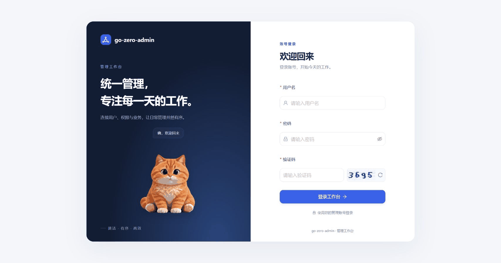
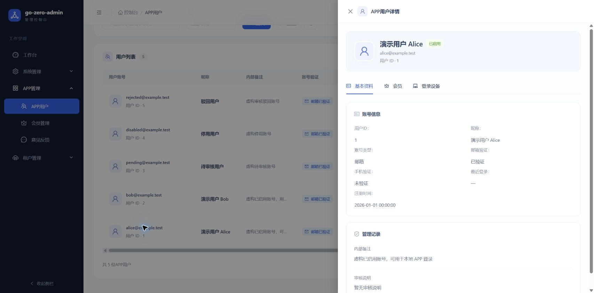

# go-zero-admin

[](https://github.com/yh-zero/go-zero-admin/actions/workflows/ci.yml)
[](https://www.bilibili.com/video/BV15mW76qE3J/)

基于 **go-zero + React 19 + Ant Design 6** 的开源管理后台，集成权限管理、APP 用户、AI 对话、知识库与审批工作流，适合作为业务系统的开发起点。

后端为 **1 个 HTTP API + 5 个 RPC 服务**（admin / app / file / ai / tenant），配套 MySQL、Redis、Qdrant、RustFS 和 Docker Compose。

## 功能

| 模块 | 主要能力 |
|---|---|
| 系统与权限 | 用户、角色、菜单、部门、字典、文件、审计；JWT、Casbin 与部门数据范围 |
| APP 管理 | 用户资料、会员、设备、账号状态与反馈 |
| AI 与知识库 | 流式对话、TXT/Markdown 后台导入、带来源回答、反馈复核与质量验收 |
| 流程与运行 | 多步骤、审批、版本管理、运行记录与结果对照 |
| 用量与额度 | 模型用量统计与额度策略 |
| 租户管理 | 租户状态和生命周期接口，运行栈需另行配置 |

## 快速开始

准备 **Go 1.27.3、PowerShell、Docker（Linux 容器）及 Compose、Node.js 24、pnpm 11.28.5**。版本以 [go.mod](go-zero-admin/go.mod) 和 [package.json](go-zero-admin-react/package.json) 为准。

克隆使用 `git clone --recursive`；已克隆的仓库执行 `git submodule update --init`。

### 启动后端

从仓库根目录打开 PowerShell：

```powershell
cd go-zero-admin
if (-not (Test-Path -LiteralPath .env.local)) { Copy-Item .env.local.example .env.local }
powershell -NoProfile -ExecutionPolicy Bypass -File .\data\scripts\build-images.ps1
if ($LASTEXITCODE -ne 0) { throw "后端编译失败，停止启动" }
docker compose --env-file .env.local up -d --build --wait
if ($LASTEXITCODE -ne 0) { throw "Compose 启动失败，请检查日志" }
```

Dockerfile 使用宿主机预编译的 Linux 二进制；首次启动或修改后端代码后，须先运行构建脚本。基础镜像需可拉取或已缓存。

### 启动前端

另开终端，从仓库根目录执行：

```powershell
cd go-zero-admin-react
pnpm install --frozen-lockfile
pnpm dev
```

访问 **[http://127.0.0.1:5999](http://127.0.0.1:5999)**，演示管理员：`admin / Admin@123456`。默认开启图形验证码，前端代理到 API `7001` 端口；演示凭据仅限本地开发，已有库沿用实际密码。

- **数据库**：[mysql-all.sql](go-zero-admin/data/db/init/mysql-all.sql) 在 MySQL 空数据卷首次启动时自动导入，已有卷不会自动更新。该 SQL 会重建业务表，不能作为已有库的升级脚本。
- **可选配置**：AI 和邮件不影响基础后台启动，按[配置模板](go-zero-admin/.env.local.example)填写本地 `.env.local`，真实凭据不提交。
- **启动与排障**：详见[开发手册](ai_document/dev-guide.md)，包含宿主调试、配置位置和数据库维护。

## AI 与知识库使用

### 配置模型与检索

在后端 `.env.local` 配置所需密钥：聊天默认使用 DeepSeek（`AI_DEEPSEEK_KEY`）；知识库另需独立的 Qwen Embedding（`AI_QWEN_KEY`）与 Qdrant，Compose 已包含 Qdrant。修改环境变量后需重新创建 `ai-rpc` 容器，切换模型与宿主调试见[配置说明](ai_document/dev-guide.md#ai-与邮件)。

模型生成与 Embedding 按供应商计费；失败或 0 token 不表示免费，token 提醒不代表费用封顶。

### 从资料到有来源的回答

1. 进入 **AI 功能 → 知识库**，新建知识库，粘贴文本或导入 UTF-8 的 TXT/Markdown；每篇最多 **64 KiB**，等待资料变为“可使用”。
2. 测试资料检索，或填写问题直接“开始分析”，查看来源片段与运行记录；AI 对话中也可选择该知识库并启用“仅依据资料回答”。
3. 按需评价、复核答案，在“质量验收”中运行题集，或将分析保存为常用流程。详细操作与评测工具见[开发手册](ai_document/dev-guide.md#3-日常开发与验证流程)和[知识库文档](ai_document/ai-rag/README.md)。

知识库仅供本人使用，分析基于检索片段，相似度不代表答案正确率；当前不支持 PDF/Office/OCR、跨用户共享、混合检索、重排或全库全文审阅。

## 项目结构与文档

```text
├── go-zero-admin/          Go 后端、数据与部署配置
├── go-zero-admin-react/    React 管理前端
└── ai_document/            开发文档、契约与截图
```

- [开发手册](ai_document/dev-guide.md)：环境、启动、日常开发与排障
- [API 契约](ai_document/api-contract.md)：接口、权限与业务语义
- [知识库与评测](ai_document/ai-rag/README.md)：演示资料、题集和评测工具
- [前端说明](go-zero-admin-react/README.md) · [开发规范](AGENTS.md) · [架构规划](ai_document/refactor-plan.md)
- [已知问题](ai_document/README.md#后端剩余事项) · [验证证据](ai_document/validation-evidence.md)

## 界面预览

### 猫咪登录



### 工作台


### 部门管理


### 菜单与角色授权


### APP 管理




### 租户管理


