# go-zero-admin

基于 **go-zero + React** 的前后端分离管理后台，提供权限、组织、文件、审计及 APP 用户管理，可作为业务系统的开发起点。

后端采用 **1 个 HTTP API + 5 个 RPC 服务**（admin / app / file / ai / tenant），前端采用 React 19、TypeScript、Ant Design 6。

## 主要功能

| 模块 | 功能 |
|---|---|
| 工作台 | 按当前部门和授权展示统计、最近操作与常用入口 |
| 用户与个人中心 | 用户筛选、角色分配、资料/头像/密码维护、登录设备和服务端退出 |
| 角色与权限 | 页面入口与操作独立授权，结合 JWT、Casbin 和部门数据范围控制访问 |
| 菜单管理 | 目录和页面树，按所属页面维护操作权限 |
| 部门管理 | 组织树、负责人账号、直属成员及部门身份切换，成员读取遵循数据范围 |
| 字典与 API 资源 | 字典编码及可选值维护、接口资源目录查询与登记维护 |
| 文件与审计 | 文件上传、访问和引用保护；操作审计与详情查询 |
| APP管理 | 资料/会员/设备详情、昵称及内部备注、审核启停、头像、会员套餐选择与开通撤销、反馈回复 |
| AI 接口 | 会话、工具、手动工作流、任务与审批 |
| 租户接口 | 创建、查询、启停、删除与管理员重置 |

“APP管理”与“系统管理”同级，包含 APP用户、会员管理、意见反馈三个页面；AI、租户目前提供 HTTP/RPC 接口。App 端另有独立的认证、资料、会员和反馈接口。

## 快速开始

准备 **Go 1.27.3、PowerShell、Docker（Linux 容器）及 Compose、Node.js 24、pnpm 11.28.5**。

在仓库根目录打开 PowerShell，启动后端：

```powershell
cd go-zero-admin
if (-not (Test-Path -LiteralPath .env.local)) { Copy-Item -LiteralPath .env.example -Destination .env.local }
# 按需编辑 .env.local，填写 AI Key、邮件账号和凭据
powershell -NoProfile -ExecutionPolicy Bypass -File .\data\scripts\build-images.ps1
docker compose --env-file .env.local up -d --build --wait
docker compose --env-file .env.local ps
```

Dockerfile 使用宿主机预编译的 Linux 二进制；首次启动或修改后端代码后，先执行上述构建脚本。基础镜像需可拉取或已在本地缓存。

另开终端，从仓库根目录启动前端：

```powershell
cd go-zero-admin-react
pnpm install --frozen-lockfile
pnpm dev
```

访问 [http://127.0.0.1:5999](http://127.0.0.1:5999)，本地演示账号：`admin / Admin@123456`。前端默认将 `/v1` 和 `/ping` 代理到 API 的 `7001` 端口。

- 数据初始化：空数据卷首次启动会自动导入 [完整初始化 SQL](go-zero-admin/data/db/init/mysql-all.sql)；已有数据卷不会自动更新结构。
- 登录验证码：由 admin-rpc 的 `Captcha.Enabled` 控制，默认开启；修改后重启 admin-rpc。
- 配置位置：容器使用 `go-zero-admin/docker/etc/*.yaml`，宿主运行使用各服务的 `etc/*.yaml`；AI/邮件凭据见 [.env.example](go-zero-admin/.env.example)，密钥只保存在本地配置或环境变量中。
- 可选服务：AI、邮件可按需配置。SMTP 服务器、端口及 TLS 需同步实际运行配置；真实邮箱注册等待验收范围见 [后端剩余事项](ai_document/README.md#后端剩余事项)。

服务拓扑、配置路径和排障步骤见 [开发手册](ai_document/dev-guide.md)。

## 界面预览

截图使用本地演示数据。APP、部门、菜单及角色授权图已更新，其余保留既有截图，细节可能随版本变化。

### 猫咪登录

桌面端默认开启 Rive 猫咪互动：呼吸、眨眼、鼠标跟随，输入密码时捂眼，登录成功/失败时给出反馈。小屏幕隐藏装饰角色，加载失败时显示静态备用图。

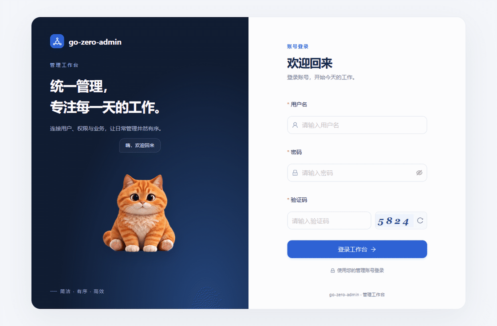

动图来自实际登录页面，账号、验证码和登录结果使用演示数据。素材与交互细节见 [登录猫动画维护](ai_document/dev-guide.md)。

### APP管理

统一查看用户资料、会员和登录设备，维护账号状态、内部备注及用户反馈。

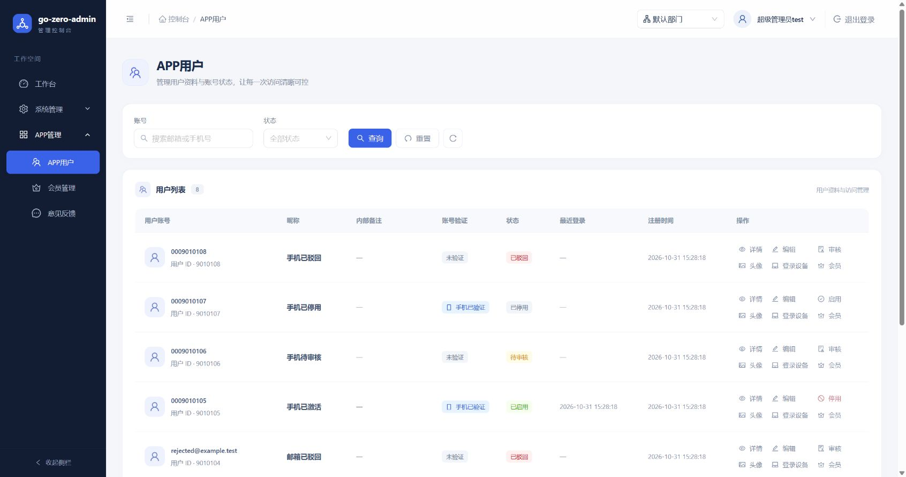

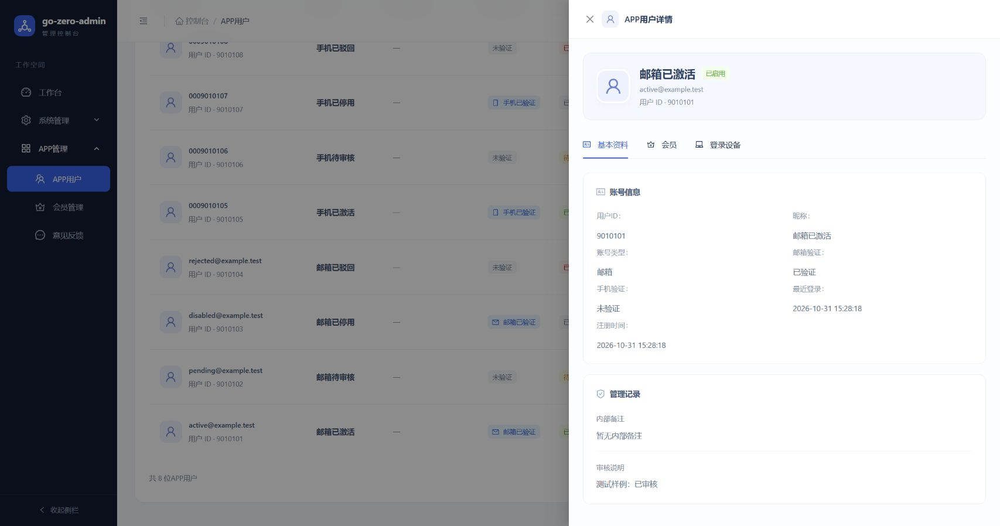

### 部门管理

组织树、部门概览与直属成员分区展示，负责人和成员读取遵循权限范围。

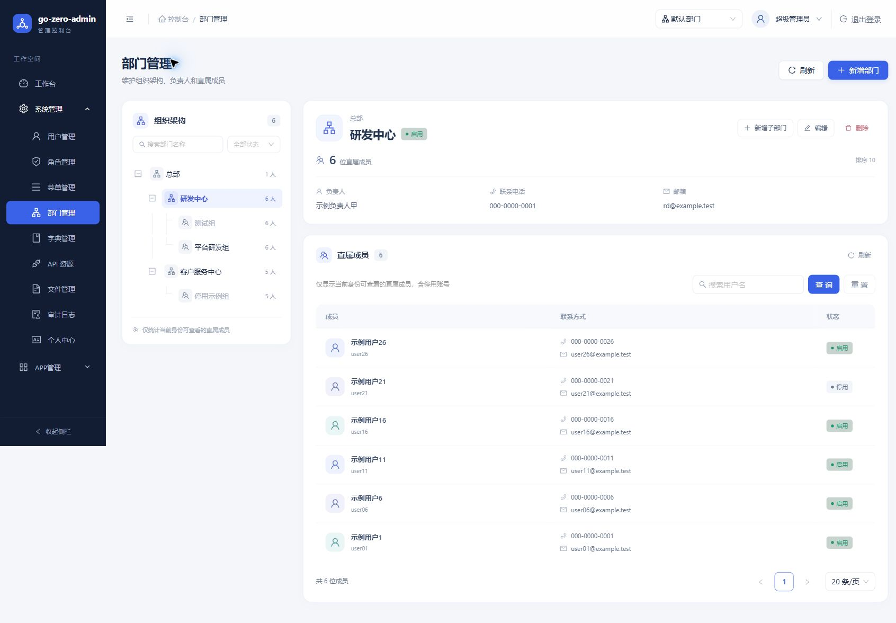

### 工作台

查看当前身份可访问的统计和常用入口。

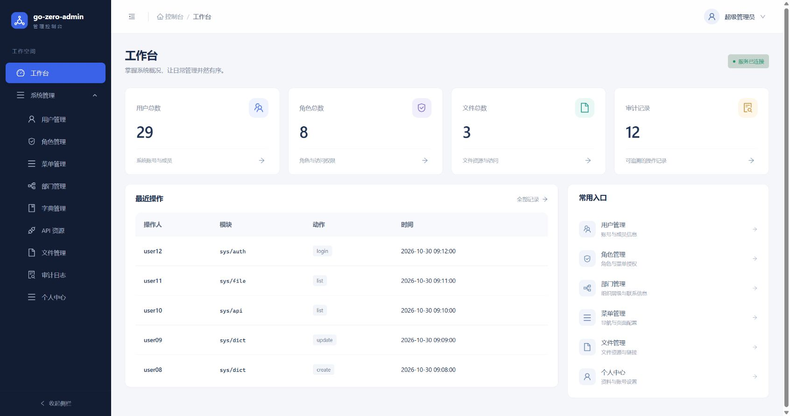

### 用户管理

按用户名、昵称、部门和状态筛选，维护账号资料与角色。

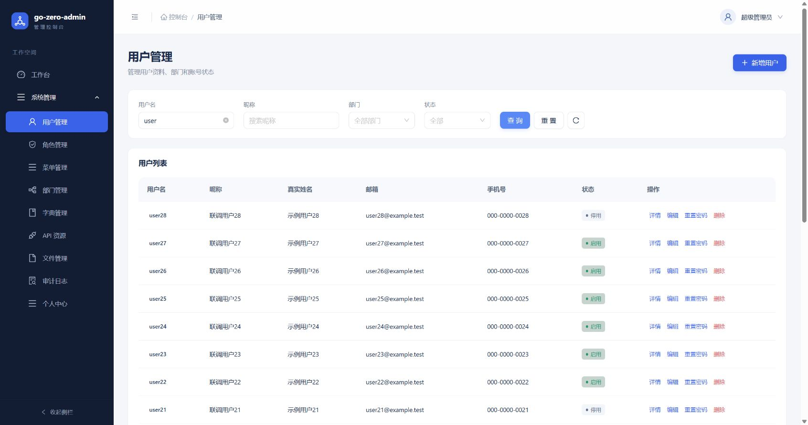

### 角色与菜单

页面入口与操作权限分开配置，菜单主区展示目录和页面树。

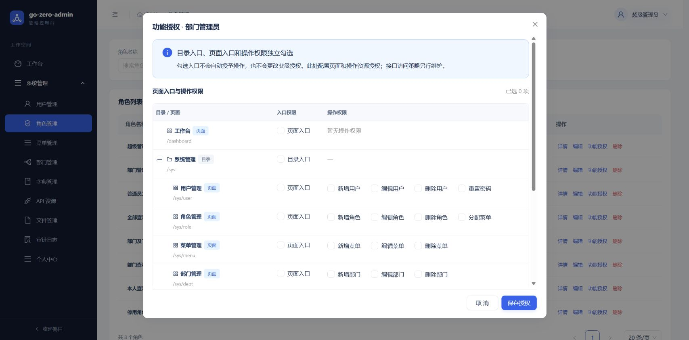

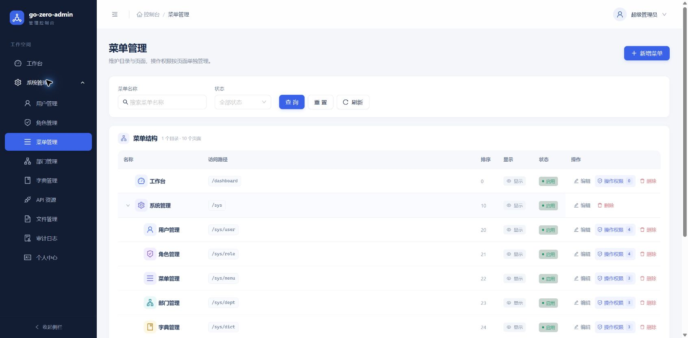

### 字典与 API 资源

维护字典编码和可选值，检索接口资源目录。

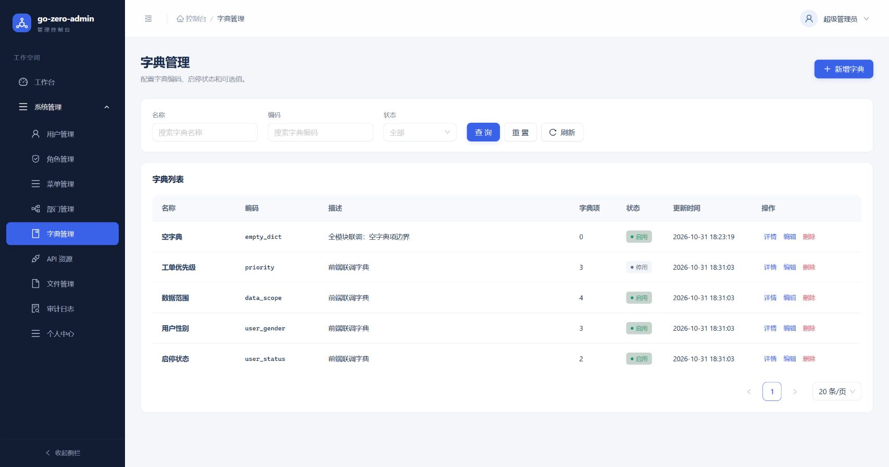

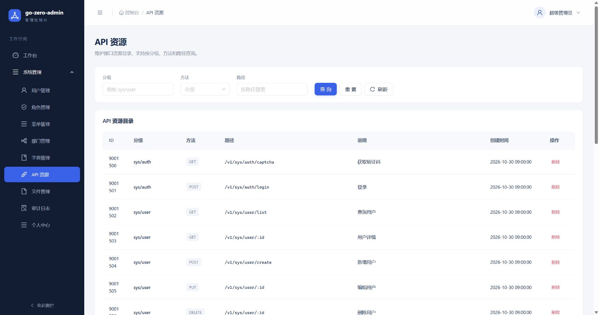

### 文件与审计

查看文件可见性和引用，查询操作人、结果、耗时及详情。

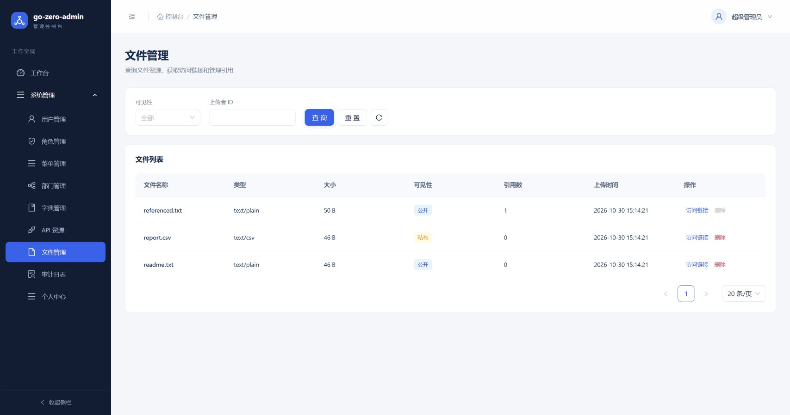

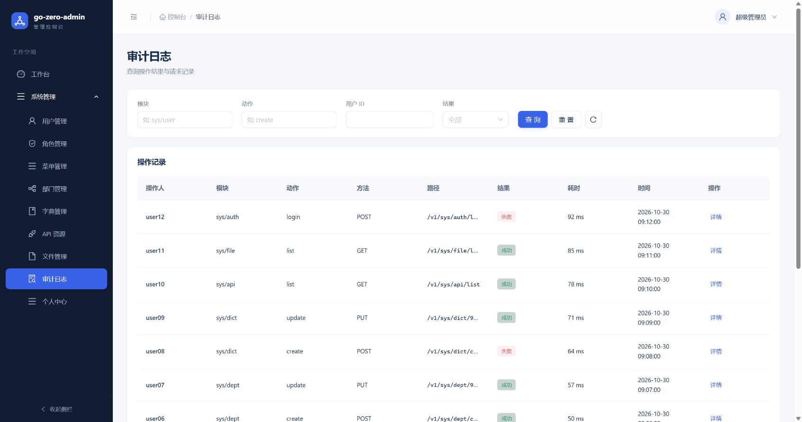

## 技术栈

| 层级 | 主要技术 |
|---|---|
| 后端 | Go 1.27.3、go-zero 1.10.3、gRPC、JWT、Casbin、Eino |
| 前端 | React 19、TypeScript、Vite 8、Ant Design 6、TanStack Query、zustand、Rive |
| 数据与部署 | MySQL 9.7、Redis 8、RustFS、goctl model / sqlx、Docker Compose、Nginx |

具体版本以 [go.mod](go-zero-admin/go.mod)、[package.json](go-zero-admin-react/package.json) 和锁文件为准。

## 仓库结构

```text
├── go-zero-admin/          后端
│   ├── application/        admin / app / file / ai / tenant
│   ├── data/               完整初始化 SQL、生成/自检脚本
│   ├── docker/             服务配置、Nginx、租户栈模板
│   └── pkg/                鉴权、存储、AI 等公共能力
├── go-zero-admin-react/    React 管理前端
└── ai_document/            项目文档与界面截图
```

## 相关文档

| 文档 | 内容 |
|---|---|
| [开发手册](ai_document/dev-guide.md) | 拓扑、启动、初始化与排障 |
| [API 契约](ai_document/api-contract.md) | 接口约定与当前验证范围 |
| [后端剩余事项](ai_document/README.md#后端剩余事项) | 待配置、待验收事项 |
| [架构规划](ai_document/refactor-plan.md) | 架构与后续方向 |
| [前端说明](go-zero-admin-react/README.md) | 页面范围、开发命令与对接约定 |
| [登录猫动画维护](ai_document/dev-guide.md) | 素材、交互与验证范围 |
| [开发规范](AGENTS.md) | 通用约定及前后端规范入口 |
