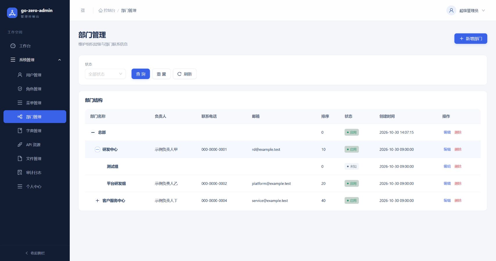

# go-zero-admin

基于 **go-zero + React** 的前后端分离管理后台，提供用户、角色、菜单、部门、字典、文件和审计查询等基础功能，适合作为业务管理系统的开发起点。

后端采用 **1 个 HTTP API + 5 个 RPC 服务**，覆盖 admin、app、file、ai、tenant 五个模块；前端使用 React 19、TypeScript 和 Ant Design 6。

## 猫咪登录

桌面端默认开启 Rive 猫咪互动：闲置时呼吸、眨眼并跟随鼠标转头，输入密码时捂眼，登录成功或失败时给出对应反馈。小屏幕隐藏装饰角色，资源加载失败时使用静态备用图。


动图录制自实际登录页面；账号、验证码和登录结果使用演示数据，仅展示交互效果。

素材来源、交互细节与验证范围见 [登录猫咪接入说明](ai_document/rive-login-cat.md)。

## 主要功能

| 模块 | 说明 |
|---|---|
| 工作台 | 用户、角色、文件、审计数量概览与常用入口 |
| 用户与个人中心 | 用户筛选、角色分配、资料与头像维护、账号状态和密码管理、设备会话管理 |
| 角色与权限 | 页面入口与操作独立授权，结合 JWT、Casbin 和部门数据范围控制访问 |
| 菜单与部门 | 目录和页面树、按页面维护操作权限、多级部门维护与当前部门切换 |
| 字典与 API 资源 | 字典及可选值维护，接口资源查询、路由同步与登记维护 |
| 文件与审计 | 文件上传、访问链接、删除与引用保护；写请求审计、记录筛选和详情查看 |
| App 接口 | 独立用户认证、资料、审核与会员管理 |
| AI 接口 | 会话、工具、工作流、任务与审批 |
| 租户接口 | 创建、查询、启停、删除与管理员重置 |

**当前范围：** 基础管理功能已有前端页面；App、AI、租户已提供 HTTP 与 RPC 接口，尚无专属前端业务页面。认证已接入验证码、刷新令牌、服务端退出与设备会话撤销。

真实 SMTP 邮件发送和外部模型调用仍待配置后验收。已完成的本地验证不代表全部异常、并发和部署场景均已覆盖；剩余事项见 [后端待办](ai_document/backend-api-integration-issues.md)。

## 界面预览

以下为本地运行页面的实际截图，使用演示数据，审计图含预置样例。菜单与角色授权图已更新，其余保留既有截图，可能与当前细节略有差异。

### 工作台

集中查看基础统计、最近操作与常用管理入口。


### 用户管理

按用户名、昵称、部门和状态筛选，查看与维护账号资料。


### 角色管理

维护角色编码、数据范围与启停状态，按页面独立配置入口和操作权限。


### 菜单管理

主区展示目录和页面树，操作权限在所属页面的抽屉中维护。


### 部门管理

以树形结构展示组织层级和部门联系信息。



### 字典管理

维护字典编码、可选值和启停状态。


### API 资源

按分组、请求方法和路径检索接口资源目录。


### 文件管理

查看文件类型、大小、可见性及引用数，获取访问链接。


### 审计日志

查询记录的操作人、模块、结果、耗时及请求详情。


## 技术栈

| 层级 | 主要技术 |
|---|---|
| 后端 | Go 1.27.3、go-zero 1.10.3、gRPC、JWT、Casbin、Eino |
| 前端 | React 19、TypeScript、Vite 8、Ant Design 6、TanStack Query、zustand、Rive |
| 数据与部署 | MySQL 9.7、Redis 8、RustFS（S3 兼容存储）、goctl model / sqlx、Docker Compose、Nginx |

具体依赖版本以 [go.mod](go-zero-admin/go.mod)、[package.json](go-zero-admin-react/package.json) 和锁文件为准。

## 快速开始

准备 Go 1.27.3、PowerShell、Docker（Linux 容器）与 Compose、Node.js 24 和 pnpm 11.28.5。

当前 Dockerfile 打包宿主机预编译的 Linux 二进制，**首次启动或修改后端代码后，须先执行构建脚本**。Dockerfile 和 Compose 引用的基础镜像也需可拉取或已缓存在本地；配置分别位于 `docker/etc/*.yaml`（容器）和各服务的 `etc/*.yaml`（宿主运行）。

在仓库根目录打开 PowerShell，编译并启动后端及依赖服务：

```powershell
cd go-zero-admin
powershell -NoProfile -ExecutionPolicy Bypass -File .\data\scripts\build-images.ps1
docker compose up -d --build --wait
docker compose ps
```

另开终端，从仓库根目录启动前端：

```powershell
cd go-zero-admin-react
pnpm install --frozen-lockfile
pnpm dev
```

访问 [http://127.0.0.1:5999](http://127.0.0.1:5999)。前端开发服务器将 `/v1` 和 `/ping` 代理到本地 API 的 `7001` 端口。

空数据卷首次启动时自动导入 [完整初始化 SQL](go-zero-admin/data/db/init/mysql-all.sql)；已有数据卷不会自动更新表结构。登录账号、本地配置与排障入口见 [本地开发环境](ai_document/dev-env.md)，接口行为和当前验证状态以 [API 契约](ai_document/api-contract.md) 与 [后端待办](ai_document/backend-api-integration-issues.md) 为准。密钥与密码放本地配置或环境变量，不写入前端变量或提交到仓库。

## 仓库结构

```text
├── go-zero-admin/          后端
│   ├── application/        admin / app / file / ai / tenant
│   ├── data/               初始化数据与生成/自检脚本
│   ├── docker/             服务配置、Nginx 与租户栈模板
│   └── pkg/                鉴权、存储、AI 等公共能力
├── go-zero-admin-react/    React 管理前端
└── ai_document/            项目文档与界面截图
```

## 相关文档

| 文档 | 内容 |
|---|---|
| [本地开发环境](ai_document/dev-env.md) | 服务拓扑、启动、初始化与排障 |
| [API 契约](ai_document/api-contract.md) | 前后端共享接口约定 |
| [架构与演进规划](ai_document/refactor-plan.md) | 架构设计与后续方向 |
| [前端说明](go-zero-admin-react/README.md) | 页面范围、开发命令与对接约定 |
| [登录猫咪接入说明](ai_document/rive-login-cat.md) | 动画素材、交互细节、生成入口与验证范围 |
| [后端待办](ai_document/backend-api-integration-issues.md) | 剩余待办与验收边界 |
| [开发规范](AGENTS.md) | 仓库通用约定与两端规范入口 |
