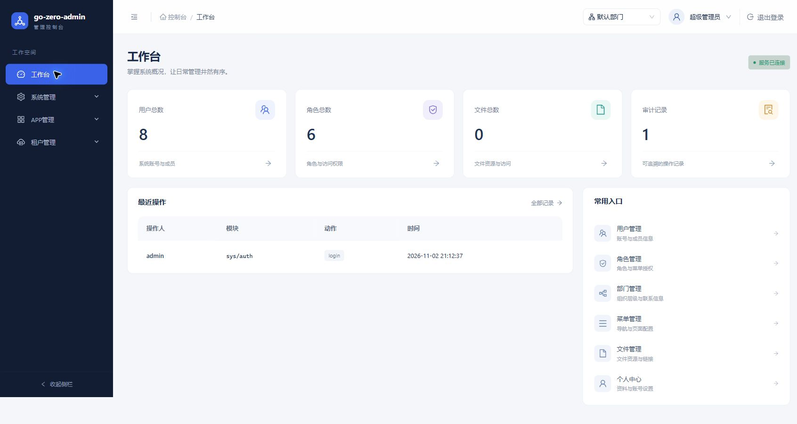
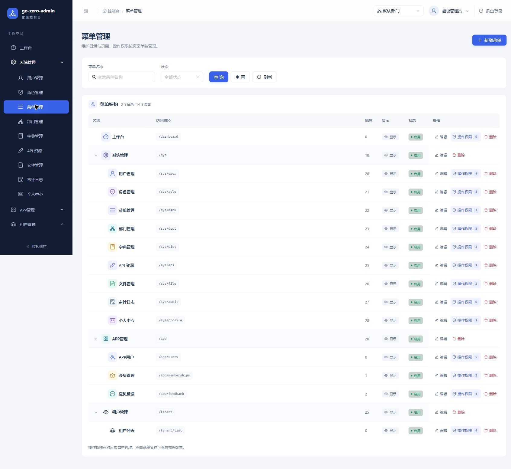
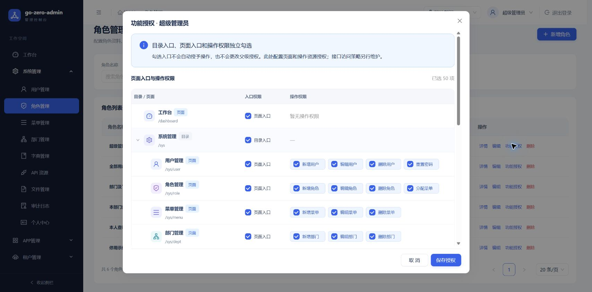

# go-zero-admin

[](https://github.com/yh-zero/go-zero-admin/actions/workflows/ci.yml) · [视频教程](https://www.bilibili.com/video/BV15mW76qE3J/) · [MIT 许可证](LICENSE)

go-zero-admin 是基于 go-zero、React 和 Ant Design 的开源管理后台。开箱即可管理用户、部门、角色权限、文件和审计记录。配置模型后，还可以用自己的资料进行知识库问答，运行带审批的工作流并查看用量。

## 快速开始

在本机体验用户、部门和角色管理，只需 Git、已启动的 Docker（支持 `linux/amd64` 的 Linux 容器）和 Docker Compose 2.24 或更高版本。首次构建需要联网下载镜像、Go 模块和前端依赖，编译在容器中完成。

```sh
git clone --recursive https://github.com/yh-zero/go-zero-admin.git
cd go-zero-admin
docker compose up -d --build --wait
```

命令成功后打开[本地管理后台](http://127.0.0.1:18080)。全新数据卷的演示账号是 `admin`，密码是 `Admin@123456`。输入页面上的图形验证码，登录后从工作台进入 **系统管理 → 用户管理**，在「用户列表」中确认能看到初始化的管理员。

用完后在**仓库根目录**运行 `docker compose stop`。下次在同一目录运行 `docker compose up -d --wait`，即可继续使用演示卷里的数据。若端口已被占用，或启动未就绪，见[演示端口与排障](ai_document/dev-guide.md#基础后台演示)。

开发 AI、App 或租户功能时，使用后端子目录里的[完整平台开发栈](ai_document/dev-guide.md#完整平台开发栈)。

### 已有数据库升级

新库由完整初始化 SQL 自动建表并写入当前迁移版本，无需额外命令。已有数据库不要重新导入初始化 SQL；先备份，再在后端目录执行：

```powershell
# 查看版本
docker compose --profile migrate run --rm migrate status

# 执行旧库升级
docker compose --profile migrate run --rm migrate up
```

迁移入口、版本状态和失败恢复见[数据库版本化迁移](ai_document/dev-guide.md#数据库版本化迁移)。

## 从资料到有来源的回答

先启动完整平台开发栈及其前端。在后端 `.env.local` 配置聊天模型密钥（默认 DeepSeek 使用 `AI_DEEPSEEK_KEY`）；知识库还需要独立的 Embedding 密钥 `AI_QWEN_KEY` 和 Compose 中的 Qdrant。修改后在后端目录运行 `docker compose --env-file .env.local up -d --force-recreate ai-rpc`。模型调用和向量化可能产生供应商费用。[模型与邮件配置](ai_document/dev-guide.md#ai-与邮件)

进入「AI 功能 → 知识库」，新建知识库，导入一篇 UTF-8 TXT 或 Markdown（每篇最多 64 KiB）。等资料显示「可使用」，输入问题查找原文，再生成带引用的回答。点击来源可打开对应原文。可以从仓库提供的[演示资料和测试问题](ai_document/ai-rag/README.md)开始。

## 开发与贡献

- 修改功能前，先读[根开发规范](AGENTS.md)，再读[后端增量规范](go-zero-admin/AGENTS.md)或[前端增量规范](go-zero-admin-react/AGENTS.md)。
- 新增接口时，从 [API 定义](go-zero-admin/application/admin/api/desc/admin.api)和[共享契约](ai_document/api-contract.md)开始，通过[生成脚本](go-zero-admin/data/scripts/gen.ps1)更新生成物。开发页面的命令与代理设置见[前端说明](go-zero-admin-react/README.md)。
- 提交改动时写明受影响的行为和验证结果。租户隔离、鉴权、数据范围及其设计依据见[架构说明](ai_document/architecture.md)。其他主题见[文档索引](ai_document/README.md)。

## 界面预览








