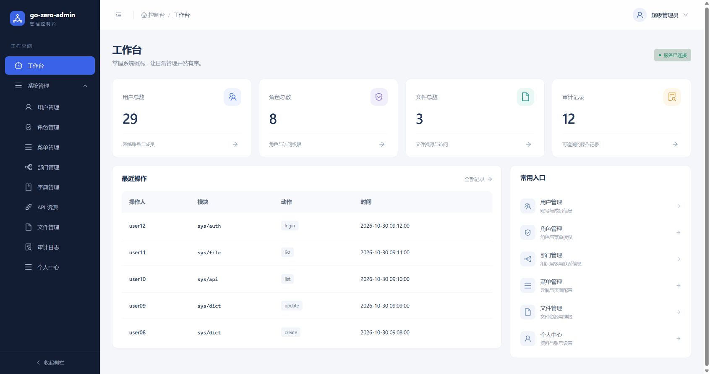
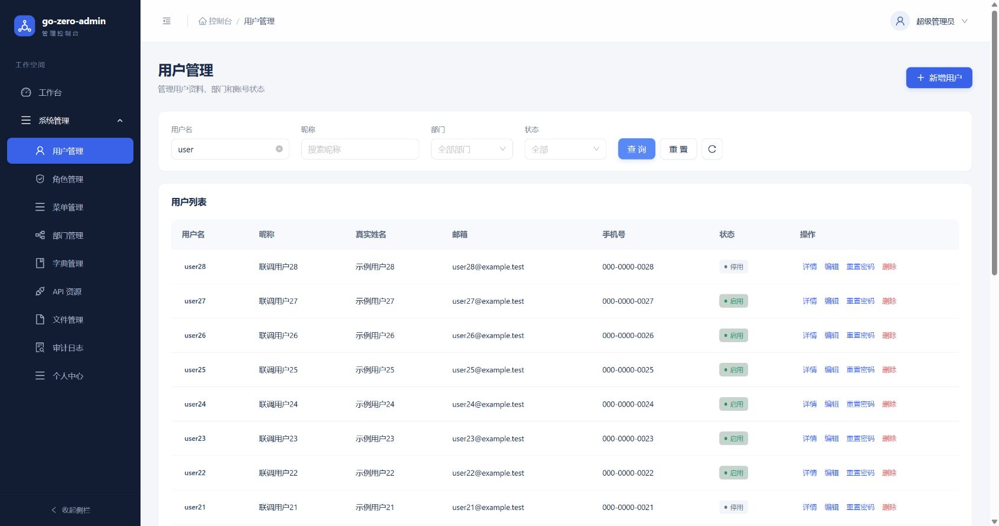
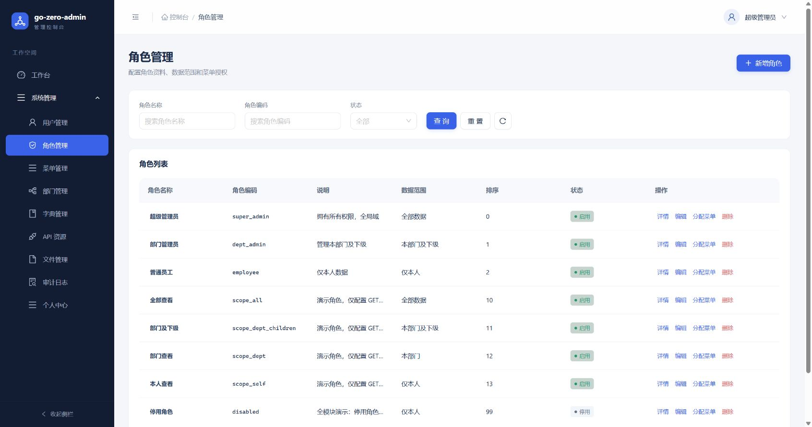
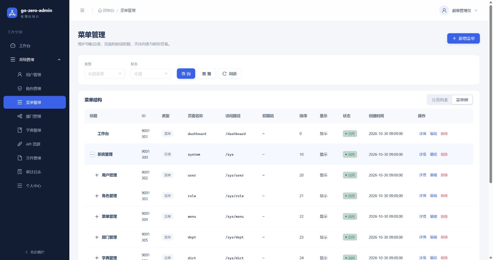
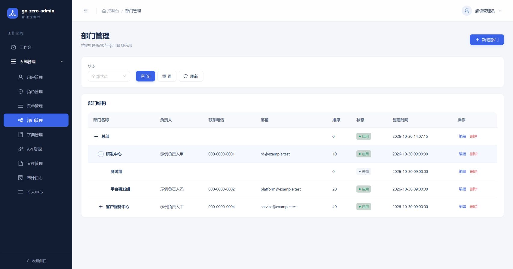
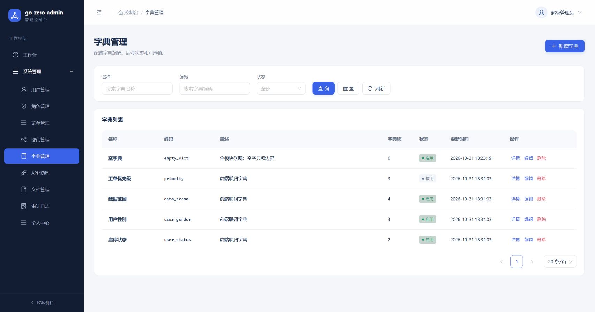
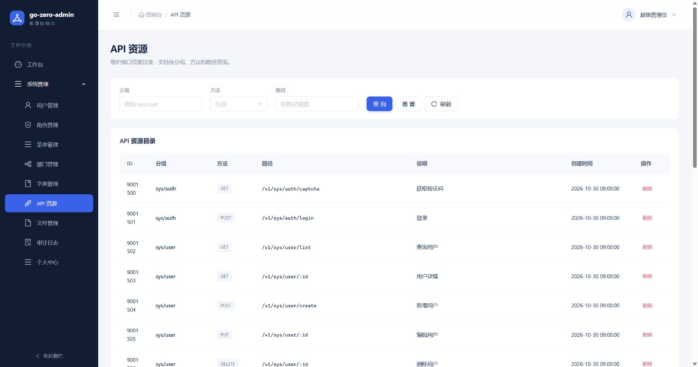
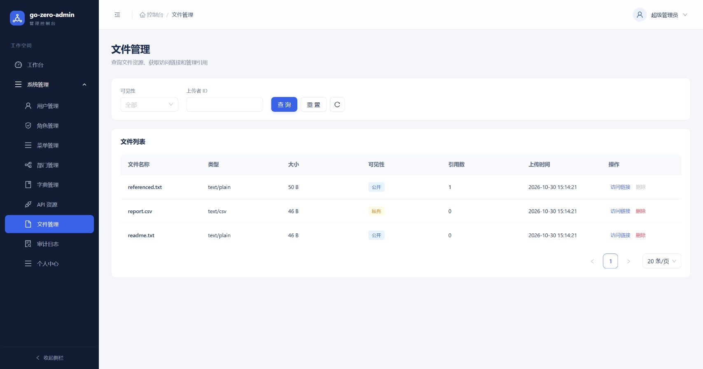
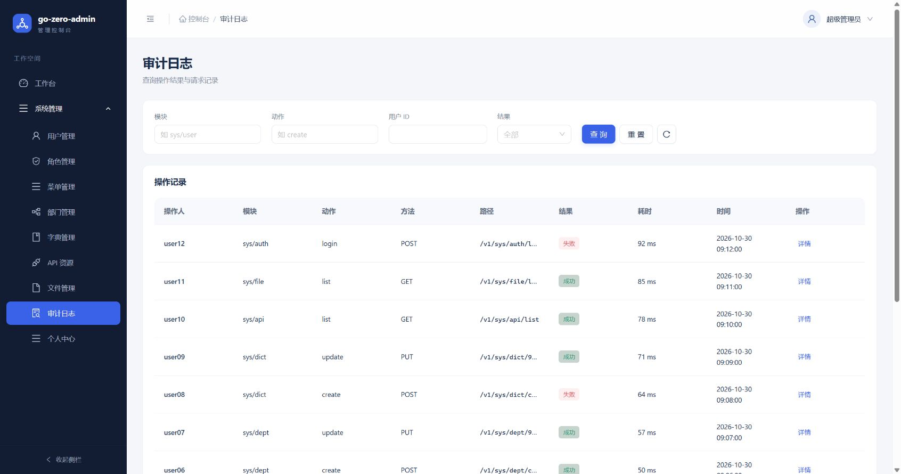

# go-zero-admin

基于 **go-zero + React** 的前后端分离管理后台，提供用户、角色、菜单、部门、字典、文件和审计查询等基础功能，适合作为业务管理系统的开发起点。

后端采用 **1 个 HTTP API + 5 个 RPC 服务**，覆盖 admin、app、file、ai、tenant 五个模块；前端使用 React 19、TypeScript 和 Ant Design 6。

## 主要功能

| 模块 | 说明 |
|---|---|
| 工作台 | 用户、角色、文件、审计数量概览与常用入口 |
| 用户与个人中心 | 用户筛选、资料维护、账号状态与密码管理 |
| 角色与权限 | 角色管理、菜单授权，结合 JWT、Casbin 和部门数据范围控制访问 |
| 菜单与部门 | 导航目录、页面和按钮权限配置，多级部门结构展示与维护 |
| 字典与 API 资源 | 字典及可选值维护，按分组、方法和路径查询接口资源 |
| 文件与审计 | 文件查询、访问链接、删除与引用保护；审计记录筛选和详情查看 |

**当前范围：** 管理后台已有对应页面；App、AI、租户目前提供相关 RPC 代码，尚无 HTTP 入口和业务页面。文件上传仅有 RPC，审计写入尚未接通。其余限制与待办见 [后端对接问题](ai_document/backend-api-integration-issues.md)。

## 界面预览

以下为本地运行页面的实际截图，使用现有演示数据；审计记录为预置样例。

### 工作台

集中查看基础统计、最近操作与常用管理入口。



### 用户管理

按用户名、昵称、部门和状态筛选，查看与维护账号资料。



### 角色管理

维护角色编码、数据范围、启停状态及菜单授权。



### 菜单管理

支持列表和树形查看，统一维护目录、页面和按钮权限。



### 部门管理

以树形结构展示组织层级和部门联系信息。



### 字典管理

维护字典编码、可选值和启停状态。



### API 资源

按分组、请求方法和路径检索接口资源目录。



### 文件管理

查看文件类型、大小、可见性及引用数，获取访问链接。



### 审计日志

查询记录的操作人、模块、结果、耗时及请求详情。



## 技术栈

| 层级 | 主要技术 |
|---|---|
| 后端 | Go 1.27.3、go-zero 1.10.3、gRPC、JWT、Casbin、Eino |
| 前端 | React 19、TypeScript、Vite 8、Ant Design 6、TanStack Query、zustand |
| 数据与部署 | MySQL 9.7、Redis 8、RustFS（S3 兼容存储）、goctl model / sqlx、goose、Docker Compose、Nginx |

具体依赖版本以 [go.mod](go-zero-admin/go.mod)、[package.json](go-zero-admin-react/package.json) 和锁文件为准。

## 快速开始

准备 Docker Compose、Node.js 24 和 pnpm 11.28.5；若在宿主机运行后端，另需 Go 1.27.3。

在仓库根目录打开终端，启动后端及依赖服务：

```powershell
cd go-zero-admin
docker compose up -d --build --wait
```

另开终端，从仓库根目录启动前端：

```powershell
cd go-zero-admin-react
pnpm install --frozen-lockfile
pnpm dev
```

访问 [http://127.0.0.1:5999](http://127.0.0.1:5999)。前端开发服务器将 `/v1` 和 `/ping` 代理到本地 API 的 `7001` 端口。

空数据卷首次启动时会自动导入初始化数据；登录账号、本地配置与排障步骤见 [本地开发环境](ai_document/dev-env.md)。

## 仓库结构

```text
├── go-zero-admin/          后端
│   ├── application/        admin / app / file / ai / tenant
│   ├── data/               初始化数据、迁移与生成/自检脚本
│   ├── docker/             服务配置、Nginx 与租户栈模板
│   └── pkg/                鉴权、存储、AI 等公共能力
├── go-zero-admin-react/    React 管理前端
└── ai_document/            项目文档与界面截图
```

## 相关文档

| 文档 | 内容 |
|---|---|
| [本地开发环境](ai_document/dev-env.md) | 服务拓扑、启动、初始化与排障 |
| [API 契约](ai_document/api-contract.md) | 前后端共享接口约定 |
| [架构与演进规划](ai_document/refactor-plan.md) | 架构设计与后续方向 |
| [前端说明](go-zero-admin-react/README.md) | 页面范围、开发命令与对接约定 |
| [后端对接问题](ai_document/backend-api-integration-issues.md) | 当前限制与待修复事项 |
| [开发规范](AGENTS.md) | 仓库通用约定与两端规范入口 |
