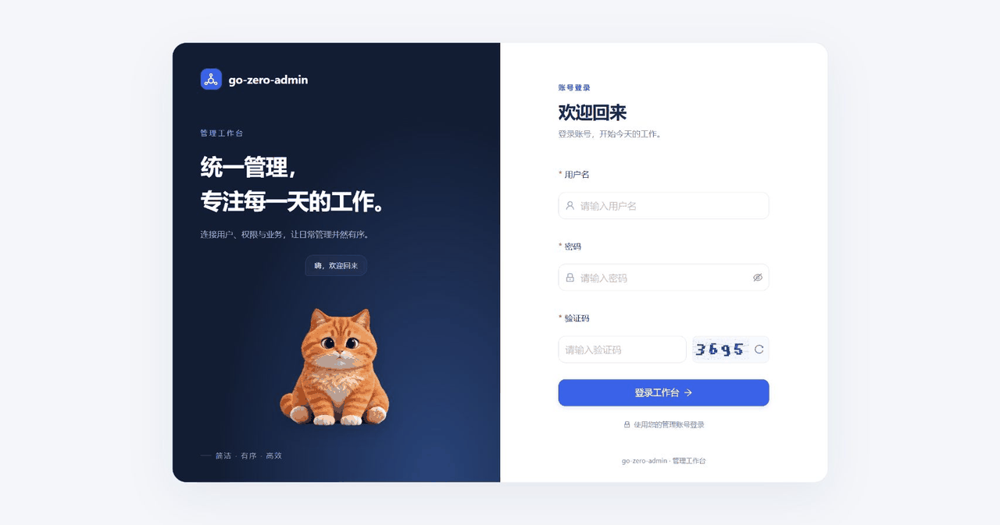

# go-zero-admin 开发手册

> 环境拓扑与联调 SOP + 历史事故对策 + 功能维护。契约见 [api-contract.md](api-contract.md)，架构决策见 [refactor-plan.md](refactor-plan.md)。

> 联调/验证前先读本文。环境异常时按 §3 排查，别猜。

## 1. 标准拓扑

全部后端由 `go-zero-admin/docker-compose.yml` 统一管理（Docker Desktop 归组为 `gozero-platform`）：

| 组件 | 容器 | 宿主地址 | 说明 |
|---|---|---|---|
| MySQL 9.7 | `gozero-new-mysql` | `127.0.0.1:3307` | 单库 `gozero_admin`（含 tenant_registry 租户登记表）；统一导入 [初始化 SQL](../go-zero-admin/data/db/init/mysql-all.sql) |
| Redis 8 | `gozero-redis8` | `127.0.0.1:16379` | 缓存 + Casbin 策略通知频道 |
| RustFS | `gozero-integration-rustfs` | `127.0.0.1:19000`（控制台 :19001） | S3 兼容对象存储 |
| admin-rpc | `gozero-platform-admin-rpc-1` | 仅容器网络 :6001 | |
| app-rpc / file-rpc / ai-rpc | `gozero-platform-*-1` | 仅容器网络 :6002-6004 | |
| tenant-rpc | `gozero-platform-tenant-rpc-1` | 仅容器网络 :6005 | 仅平台栈 |
| admin-api | `gozero-platform-api-1` | `127.0.0.1:7001` | REST 网关，前端代理目标 |
| nginx | `gozero-platform-nginx-1` | :80 | 多租户子域名路由 |
| 前端 dev | `go-zero-admin-react` → http://localhost:5999 | `/v1` 已代理到 7001 | 宿主 pnpm dev，不进 compose |

种子账号：`admin / Admin@123456`（默认需填写一次性图片验证码；由 admin-rpc 的 `Captcha.Enabled` 控制，修改后重启该服务。`image_base64` 编码的是 PNG 图片，解码后不会直接得到答案文本）。

**配置双套制**（改配置时注意是否两套都要同步）：
- 容器内服务读 `docker/etc/*.yaml`（compose 卷挂载；地址为容器网络服务名 `mysql:3306` / `redis:6379` / `rustfs:9000`）
- 宿主 `go run` 热调读 `application/*/etc/*.yaml`（地址为 `127.0.0.1` + 宿主映射端口 3307/16379/19000）

## 2. 启动

### 方式一：compose 一键全量（日常）

Dockerfile 打包宿主机预编译的 Linux 二进制；首次启动或修改后端代码后，先执行构建脚本，再启动 Compose。

```powershell
cd go-zero-admin
powershell -NoProfile -ExecutionPolicy Bypass -File .\data\scripts\build-images.ps1
docker compose up -d --build --wait
docker compose ps              # 确认服务状态
````

前端（单独，宿主运行）：

```powershell
cd go-zero-admin-react; pnpm dev   # http://localhost:5999
````

### 方式二：单服务 go run 热调（改代码时用）

```powershell
docker compose up -d mysql redis rustfs   # 只起依赖
go run ./application/admin/rpc -f application/admin/rpc/etc/admin.yaml   # 其余服务以此类推
````

注意：宿主 `go run` 与 compose 同时跑同一服务会抢端口（尤其 api 的 7001），二选一。

### 数据初始化（首次克隆）

[data/db/init/mysql-all.sql](../go-zero-admin/data/db/init/mysql-all.sql) 是数据库初始化唯一入口，包含全部表结构与开发数据。每次新建库均完整导入该文件，不维护增量升级流程。Compose 已将其目录挂到 MySQL 的 `/docker-entrypoint-initdb.d`，**空数据卷首次 `docker compose up -d` 自动导入，无需手动操作**；已有数据卷不会重复执行，也不会自动更新结构。

初始化账号：`admin` / `Admin@123456`（仅本地开发，生产必改）；DB root 统一 `123456`。

从零初始化统一导入上述完整 SQL。需要手工导入时，在新建库环境中使用 MySQL 客户端执行同一文件。

生成数据模型前，先将完整 SQL 导入开发库，再执行 `data/scripts/gen.ps1 model <模块> <表>`；goctl model 仍从已导入的开发库反射表结构。

2026-11-02 本地单库对齐完成：租户表保留原数据迁入 `gozero_admin`，补齐两列和注释，旧库及两张版本表已清理。最终与初始化 SQL 对比为 19 表、203 列、58 个索引，定义和注释无差异；原业务数据、自增计数及本地 env 保留，正常登录更新和审计追加未回滚。双库备份已实际恢复验证，保存在仓库同级 `go-zero-admin-backups/20261102-single-db-1793619713487/before-single-db.sql`，含配置及业务数据，不入库。

模型通过 `gen.ps1 model tenant tenant_registry` 生成，进度 SQL 归入现有 model。临时 overlay 的 model 9 项、真实 reportStep helper 1 项及运行态只读 RPC 79 项通过，重启后 RPC 和结构复查仍通过；后端六项自检、前端类型/构建退出 0。model 命令为 `go test -overlay ../.tmp_schema_alignment_validation/overlay.json -run '^TestSchemaAlignment' -count=1 -v ./application/tenant/rpc/internal/model`，helper 命令同上并改用 `-run '^TestSchemaAlignmentReportStepHelper$'` 和 `./application/tenant/rpc/internal/logic/tenantservice`。本轮未对现有租户执行创建、启停或删除栈。11 个 Compose 容器及 5999 前端已重启，API/Nginx 就绪、原会话与工作台正常；测试容器、专用卷、overlay、探针及日志已清理，13317/17379 已释放。

2026-11-02 租户导航恢复：本地已有 3 条演示租户，但缺少菜单。补入初始化 SQL 中的顶层“租户管理”和“租户列表”，仅关联超级管理员；未添加写操作菜单或更改接口授权。前端复用已有读取接口补齐状态筛选和只读详情，浏览器确认异常 1 条、停用 2 条、运行中/创建中为空，重置与页大小保留、不同对象详情均正常；未操作演示租户的生命周期。前端类型检查、lint、构建通过，保留既有 lint 和构建体积警告。

按用户要求，当前单库完整备份保存于 `go-zero-admin/data/db/init/20261102/gozero_admin-full.sql`（19 表，94,424 字节，含上述菜单数据）。已核对表集合、导出结束标记和 SHA256；本次未将这份新备份再次恢复到测试库。目录已 Git 忽略，未覆盖初始化入口；备份含本地业务数据，仅限本机保存。

2026-11-02 开源数据整理：再次先备份 `gozero_admin-full-before-cleanup-20261102T125430Z.sql` 至同一忽略目录，再修复本地旧部门状态、文件引用计数，精确清理 3 条历史测试菜单及 3 条旧 API 目录记录。保留其余本地业务数据，无额外业务库或多余表，19 表检查正常。备份与公开初始化文件分开，禁止将私人备份作为开源种子提交。

当前 `mysql-all.sql` 保留 19 表结构，使用虚构的部门、角色、账号、APP 会员/反馈及完整菜单、字典和 94 条实际 API 资源；文件、审计、AI 和租户登记初始为空。隔离库连续两次完整导入及 19 表检查通过，结构与本地一致；普通账号全部、本部门及下级、本部门、本人和跨部门切换等 68 项真实 RPC 断言通过，越界及无效身份明确拒绝。后端六项自检、前端类型检查与构建通过。新备份已在无网络临时库实际恢复，19 表及清理前行数核对通过；未登录访问租户及 APP 后台返回 401。

用户完成隔离库登录后，浏览器验证工作台 8 用户/6 角色、部门负责人及直属成员、50 项角色授权、5 位 APP 用户、会员与设备详情、3 条反馈及空租户列表；8 张新图（含猫咪捂眼动图）替换旧图。临时调整过的验收验证码配置已恢复默认开启，未修改日常配置；租户生命周期及外部 AI/邮件调用未在本轮重新验收。

本轮临时容器、专用网络/卷、前端进程和临时配置/探针/帧/日志已清理，15999/17001/13317/17379 已释放；日常 11 个容器保留，7001 就绪与 5999 页面返回 200。

公开种子同步修正独立租户初始化：SQL 导入与清理由现有 model 扩展负责，logic 注入 Docker 执行器；清理 APP 反馈，只保留初始超级管理员及有效授权。真实初始化 helper 先复现旧逻辑残留，再连续两次运行通过 70 项断言（含无孤儿、菜单/字典/API 保留及输入转义），后端六项自检再次通过；无端口的专用 MySQL 项目和 overlay 已清理。tenant-rpc 已重建，容器内 SQL/二进制哈希与本地一致，原本地 3 条租户读取正常；未创建实际租户应用栈。

## 3. 故障排查（按命中率排序）

### ① api 启动即退出 / 反复重启
api 启动时要经 admin-rpc 加载 Casbin 策略，rpc 未就绪会 panic——compose 已配 `restart: on-failure` 自愈。
持续失败看日志：`docker compose logs api admin-rpc --tail 50`。

API 容器重建后，若 7001 直连正常而 Nginx 返回 502，可能是 Nginx 仍保留旧上游地址。先执行 `docker compose exec -T nginx nginx -t`，确认成功后执行 `docker compose exec -T nginx nginx -s reload`，再以 `Host: localhost` 复测代理的 `/ping` 和 `/ready`；IP 直访默认站点返回 404 是域名隔离规则。

### ② 请求诡异失败（404/连接拒）
**先查端口被谁占了**——旧项目 docker 的 `gozero-api` 常占用 7001：
```powershell
netstat -ano | Select-String ':7001.*LISTENING'
docker stop gozero-api   # 暂停旧项目容器；联调完记得 docker start 恢复
````

### ③ 登录报"账号未激活"/数据改了不生效
goctl model 带 Redis 缓存，直接修改开发库后只失效本次记录对应的缓存键。先查看对应 `*_model_gen.go` 的 ID/唯一索引键前缀，再按确切 ID 和旧、新唯一值删除；授权变化通过现有策略通知触发刷新。不要清空共享 Redis，参见根规范 §7.6：
```powershell
docker exec gozero-redis8 redis-cli DEL '<本次记录的精确缓存键>'
````

### ④ docker exec 里中文乱码 / 输出被吞
- 管道传 SQL 中文会乱码：改用 `docker cp` 文件进容器再执行
- mysql 客户端密码警告吞掉输出：用 `-e MYSQL_PWD=...` 代替 `-p`

### ⑤ PowerShell 脚本执行
- ps1 文件必须 **UTF-8 with BOM**（无 BOM 中文注释会解析崩溃）
- 续行符是反引号 ` 不是反斜杠 \
- 执行策略拦截：`powershell -NoProfile -ExecutionPolicy Bypass -File <脚本>`

### ⑥ 中文种子导入后乱码（双重编码）

`docker cp` + `mysql < file` 导入中文 SQL 时，mysql 客户端默认 latin1 会把 UTF-8 字节二次编码（"租户管理"→`租户管ç†`）。
- 预防：导入命令加 `--default-character-set=utf8mb4`
- 已坏的修复：`UPDATE t SET col=CONVERT(0x<utf8hex> USING utf8mb4)`（0x 字面量绕过客户端字符集；hex 用 Node Buffer 生成保证字节准确）

### ⑥ AI 与邮件：极简 env

原 YAML 保留完整默认配置。在后端目录的 `.env.local` 填写以下三项（该文件已被 Git 忽略，空值表示尚未配置）：

```dotenv
AI_DEEPSEEK_KEY=
APP_SMTP_USERNAME=
APP_SMTP_PASSWORD=
```

环境变量按“模块 + YAML 配置层级”命名，如 `APP_SMTP_PASSWORD` 对应 App 的 `SMTP.Password`，`AI_DEEPSEEK_KEY` 对应 AI 的 `AI.DeepSeekKey`（同名 AI 节点不重复）。旧名称需同步改名，值保持不变。

AI 按 YAML 的 Provider 读取 `AI_<PROVIDER>_KEY`：非空即启用，缺失/空白则关闭，覆盖原 Enabled 开关；模型、地址和超时仍取 YAML。当前 Provider 为 deepseek，平台 Compose 已传递 DeepSeek/Qwen 的 Key，其他供应商需另补对应映射。

邮件服务器地址在 YAML 的 `SMTP.Host` 维护：容器使用 `docker/etc/app-rpc.yaml`，宿主使用 `application/app/rpc/etc/app.yaml`，按实际服务商配置。env 只需填写账号和授权码；发件邮箱依次取 YAML From、可选 `APP_SMTP_FROM`、`APP_SMTP_USERNAME`。YAML 的 `SMTP.FromName` 设置显示名称（示例“帅浩”），`SMTP.ValidSeconds` 设置验证码有效秒数（默认 600）；到期自动失效、匹配成功后删除，输错不删除。可选的 `APP_SMTP_HOST` 回退通道保留，但不列入极简模板。当前默认为 587 + STARTTLS；465 + 隐式 TLS 需另行接入，不属于此最小方案。真实密钥与授权码不要写入版本库。

首次使用先按 §2 编译，再在后端目录启动或更新对应容器：

```powershell
docker compose --env-file .env.local up -d --build --force-recreate ai-rpc app-rpc
```

`.env.local` 不会被 Go 自动读取，宿主运行时须先设置进程环境变量；env 修改后需重新创建对应容器，单独 restart 不会更新其环境。租户模板未传递这些变量，平台配置不会自动共享给租户。

## 4. 联调后清理（任务完成定义的一部分）

1. 停掉本次 `go run` 的进程；compose 栈按任务要求保留或 `docker compose stop`
2. 删除 `.tmp_*` 目录、调试日志
3. `docker start gozero-api` 恢复旧项目容器（如曾暂停）
4. `git status` 确认工作区干净


---

## 5. 踩坑清单（历史事故）

> 动手涉及 Casbin domains、多租户栈、goctl 生成、sqlx 数据层前，先查对应条目。

> 规范条目背后的真实事故。规则本体在各 AGENTS.md，本文件只讲事故与成因。

## 生成物相关

1. **pb 字段名凭记忆书写**（事故 ×5+）：`CaptchaId`/`CaptchaID`、`UserId`/`UserID` 反复写错——proto snake_case 生成的 Go 字段大小写不直觉。对策：根规范生成物查证纪律。
2. **正则批量转 proto 字段**：CamelCase→snake_case 正则把 `id`→`i_d`、`IP`→`i_p`，286 个字段逐个修。对策：禁止正则批量替换 desc/ 文件。
3. **proto package 全是 `pb`**：多模块同 package 致 protobuf 全局注册冲突，编译全过、运行时 panic。对策：后端规则 package 唯一性。
4. **goctl 对已有 main 跳过生成**：proto 加 service 后 `pb.go` 不自动注册，运行时 `unknown service`。对策：`gen.ps1 rpc` 注册检查告警。
5. **etc 双 yaml**：goctl 按 package 名生成 `aipb.yaml` 与手写 `pb.yaml` 并存。对策：`--name-from-filename` + 只保留 `<模块>.yaml`。

## 数据层

6. **`QueryRowsCtx` 直扫 pb 类型**（事故 ×7）：pb 无 `db` tag，运行时 `not matching destination to scan`。对策：本地 row struct 过渡。
7. **DATETIME 直扫 int64**：dept/role 报"数据库错误"根因。对策：SQL 层 `UNIX_TIMESTAMP()`。
8. **goctl model 缓存幽灵数据**：直接改库后 `FindOneByAccount` 命中旧缓存。对策：按生成 model 的键规则失效本次记录的 ID/唯一索引缓存；禁止用全局清空代替精确清理（§3.2）。

## 环境/工具链

9. **版本漂移**：`go get go-zero@v1.10.3` 静默失败，文档写 1.10.3 实际 1.10.0。对策：验证实际生效版本。
10. **端口被旧项目占用**：旧项目 `gozero-api` 容器占 7001，新服务"启动成功"但请求全 404。对策：§3.1。
11. **跨模块 RPC 复用连接**：`FileRpc` 复用 adminRpc 连接指向 6001，`unknown service`。对策：每个外部模块独立 client 连接。
12. **docker exec 中文乱码**：管道传 SQL 中文乱码；改用 `docker cp`。对策：§3.3。
13. **ps1 无 BOM**：UTF-8 无 BOM 脚本中文注释解析崩溃。对策：§3.4。

## 流程

14. **积攒多模块一次性 e2e**：三模块攒一起测，一次爆 3 类错误。对策：每模块立即验证（后端规则 11）。
15. **API 层直连数据库**：Casbin 初期引入，后重构为 RPC 拉策略。对策：api 层必须经 RPC client。

---

## 6. 登录猫动画维护

## 已确认需求

在登录页左侧插画区域接入 Rive 猫咪：输入密码时捂眼，登录成功和失败时分别播放对应反馈。只改前端，保留现有登录、验证码和权限接口。用户已授权使用 Rive 及所需素材，并要求桌面端互动默认开启、移除手动开启按钮。

## 完成情况

- [x] 按视频中的毛绒橘猫风格生成九种姿态，保存来源图集；通过项目脚本生成真实 `.riv` 与静态备用图。
- [x] 新增按需加载的 `LoginMascot` / `RiveLoginCat`，Rive 文件和 WASM 均随站点本地托管。
- [x] 对接密码聚焦、表单聚焦与登录结果；处理资源失败、窄屏及卸载清理。
- [x] 完成类型检查、生产构建、相关静态检查、素材测试与独立浏览器验收。

## 交互细节

| 场景 | 表现 |
|---|---|
| 闲置 | 轻微呼吸、间歇眨眼；鼠标左右移动时转头，方向切换设置不同进入与退出阈值，避免边界闪动 |
| 聚焦表单 | 朝右侧表单看，并显示陪伴提示 |
| 聚焦密码 | 分段抬爪捂眼，离开密码框后放爪；只接收聚焦状态，不读取密码 |
| 登录成功 | 开心挥爪、轻微弹起；约 1.1 秒后保存会话并进入原目标页 |
| 登录失败 | 低头轻摇与安慰提示；保留既有错误信息、验证码清空和刷新行为 |
| 资源不可用 | 显示静态备用图，成功后直接完成登录 |
| 默认启用 | 768px 及以上进入登录页即开启互动，包括系统设置为减少动态效果时；页面不再显示手动开启按钮 |
| 小屏幕 | 768px 以下隐藏装饰角色，不加载 Rive，优先保持表单可用 |

角色包含橘色虎斑、奶油色胸口、粉色肉垫和细密毛发。采用九张图片姿态与 Rive 轨道组合，并非原视频素材或实时三维模型。

## 素材与维护

- 唯一图片来源：`go-zero-admin-react/src/assets/login-cat-atlas.png`，1536 × 1536 透明图集，每格 512 × 512。
- 生成入口：从前端目录运行 `node scripts/build-login-cat.mjs public/mascots/login-cat.riv src/assets/login-cat-atlas.png`；生成物不手工编辑。
- 依赖：`@rive-app/react-canvas@4.38.0`、`@rive-app/canvas@2.48.0`；只新增这两项所需依赖。
- 维护说明：[素材来源](../go-zero-admin-react/public/mascots/README.md)、[生成器说明](../go-zero-admin-react/scripts/build-login-cat.md)。

## 验证边界

本轮验证了前端与模拟成功/失败响应的联动，没有使用真实账号重新进行后端登录，也没有改变后端、验证码或接口契约。动画不接收密码内容，成功反馈使用固定短延时，不依赖动画完成事件无限等待。Rive 现有状态机输入 API 会给出弃用提示，当前固定版本支持此 API。

## 页面截图

以下动图于 2026-11-02 从隔离初始化库的真实登录页重新录制，展示默认互动及输入密码时捂眼：



当前仓库既有未提交改动保留，本任务不自动提交或推送。
