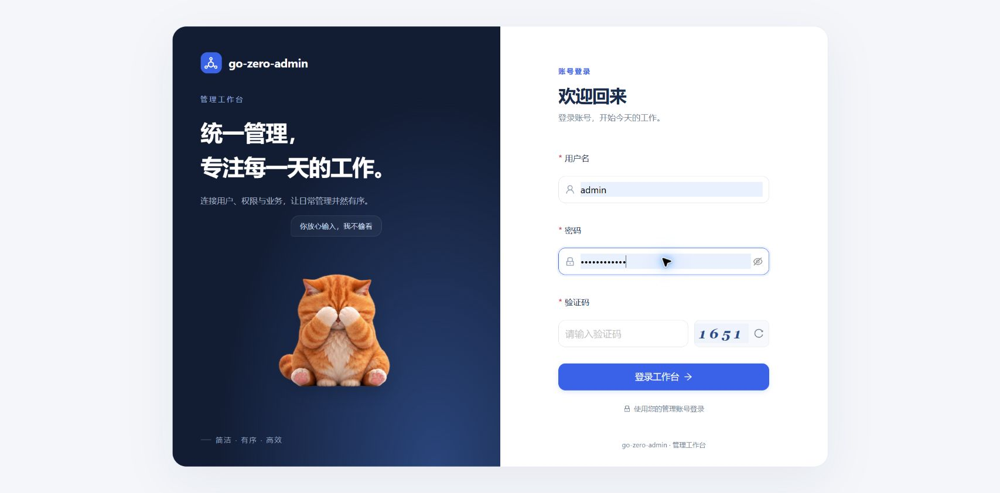
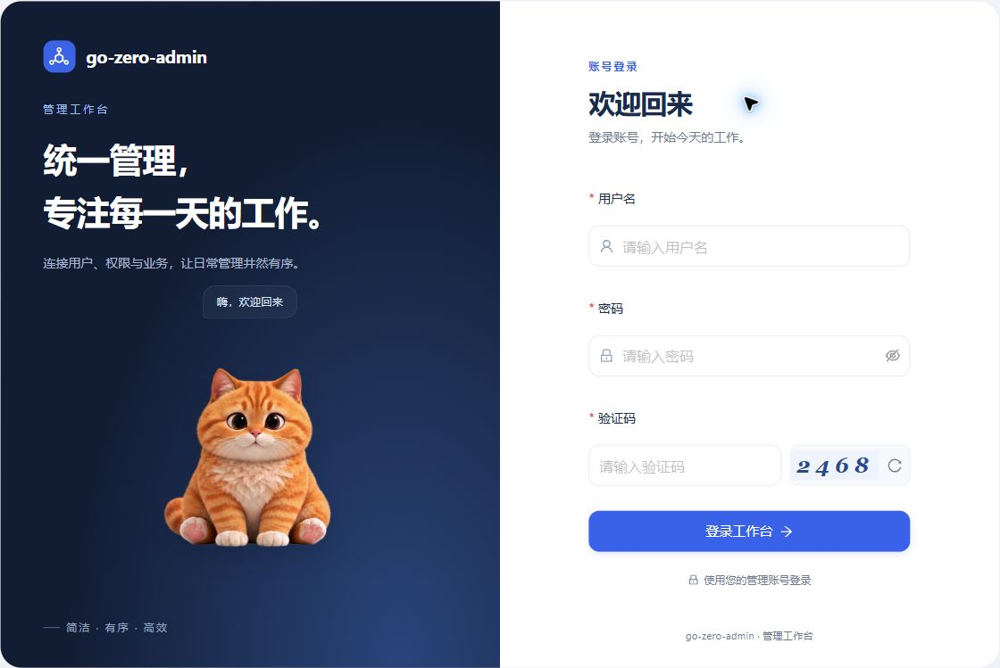

# 登录猫咪接入与验证

## 已确认需求

在登录页左侧插画区域接入 Rive 猫咪：输入密码时捂眼，登录成功和失败时分别播放对应反馈。只改前端，保留现有登录、验证码和权限接口。用户已授权使用 Rive 及所需素材，并要求桌面端互动默认开启、移除手动开启按钮。

## 完成情况

- [x] 按视频中的毛绒橘猫风格生成九种姿态，保存来源图集；通过项目脚本生成真实 `.riv` 与静态备用图。
- [x] 新增按需加载的 `LoginMascot` / `RiveLoginCat`，Rive 文件和 WASM 均随站点本地托管。
- [x] 对接密码聚焦、表单聚焦与登录结果；处理资源失败、窄屏及卸载清理。
- [x] 完成类型检查、生产构建、相关静态检查、素材测试与独立浏览器验收。

## 交互细节

| 场景 | 表现 |
|---|---|
| 闲置 | 轻微呼吸、间歇眨眼；鼠标左右移动时转头，方向切换设置不同进入与退出阈值，避免边界闪动 |
| 聚焦表单 | 朝右侧表单看，并显示陪伴提示 |
| 聚焦密码 | 分段抬爪捂眼，离开密码框后放爪；只接收聚焦状态，不读取密码 |
| 登录成功 | 开心挥爪、轻微弹起；约 1.1 秒后保存会话并进入原目标页 |
| 登录失败 | 低头轻摇与安慰提示；保留既有错误信息、验证码清空和刷新行为 |
| 资源不可用 | 显示静态备用图，成功后直接完成登录 |
| 默认启用 | 768px 及以上进入登录页即开启互动，包括系统设置为减少动态效果时；页面不再显示手动开启按钮 |
| 小屏幕 | 768px 以下隐藏装饰角色，不加载 Rive，优先保持表单可用 |

角色包含橘色虎斑、奶油色胸口、粉色肉垫和细密毛发。采用九张图片姿态与 Rive 轨道组合，并非原视频素材或实时三维模型。

## 素材与维护

- 唯一图片来源：`go-zero-admin-react/src/assets/login-cat-atlas.png`，1536 × 1536 透明图集，每格 512 × 512。
- 生成入口：从前端目录运行 `node scripts/build-login-cat.mjs public/mascots/login-cat.riv src/assets/login-cat-atlas.png`；生成物不手工编辑。
- 依赖：`@rive-app/react-canvas@4.38.0`、`@rive-app/canvas@2.48.0`；只新增这两项所需依赖。
- 维护说明：[素材来源](../go-zero-admin-react/public/mascots/README.md)、[生成器说明](../go-zero-admin-react/scripts/build-login-cat.md)。

## 首次接入验证结果（2026-10-31）

从前端目录执行，下列检查退出码均为 0：

```powershell
node node_modules/typescript/bin/tsc -b
node node_modules/vite/bin/vite.js build
node --test scripts/pngSpriteAtlas.test.mjs
node node_modules/oxlint/bin/oxlint src/pages/login/LoginPage.tsx src/pages/login/LoginMascot.tsx src/pages/login/RiveLoginCat.tsx src/pages/login/useLoginFeedback.ts scripts/build-login-cat.mjs scripts/pngSpriteAtlas.mjs scripts/pngSpriteAtlas.test.mjs
```

- PNG 模块六项测试通过，覆盖逐像素裁切、全部五种滤波、元数据与异常文件；另经 Windows 图像解码器独立比较像素一致。
- 实际安装的 Rive WASM 成功加载最终文件，确认九张图片和四个输入；状态验证覆盖转头、捂眼、放爪、中途重新聚焦及成功/失败触发。
- 独立浏览器页面使用真实登录组件及模拟接口响应，验证捂眼、失败反馈、成功反馈后跳回原目标、成功等待期间禁用重复提交。
- 成功等待期间主动离开页面，确认不会执行延迟的会话写入；素材请求失败时仍可完成登录。
- 原实现验证过系统减少动态效果时静态显示、手动开启互动的流程；该行为现已按用户要求调整为桌面端默认开启。390 × 844 窄屏无横向溢出，桌面布局显示正常。
- 构建仍提示既有共享请求代码块超过 500kB；Rive 单独按需加载，动画代码块约 346kB。
- 独立验收服务已停止，6009 端口确认释放；临时页面、模拟接口及诊断文件已删除。原有开发服务保持运行。

## 默认开启调整验收（2026-10-31）

已删除启用按钮、回调、手动启用状态及对应样式；桌面端仅按视口宽度启用动画。类型检查、生产构建及三个修改组件的 oxlint 检查退出码均为 0。真实开发页面刷新后，无需点击即可加载 Rive canvas；开启按钮数量为 0，聚焦密码框后实际显示捂眼姿态。本次未重复提交登录请求，后端无改动。



## 验证边界

本轮验证了前端与模拟成功/失败响应的联动，没有使用真实账号重新进行后端登录，也没有改变后端、验证码或接口契约。动画不接收密码内容，成功反馈使用固定短延时，不依赖动画完成事件无限等待。Rive 现有状态机输入 API 会给出弃用提示，当前固定版本支持此 API。

## 页面截图

以下截图来自独立验收页，验证码为测试展示值：




当前仓库既有未提交改动保留，本任务不自动提交或推送。
